<picture>
  <source media="(prefers-color-scheme: dark)" srcset="assets/profile-dark.svg">
  
</picture>

<h3><picture><source media="(prefers-color-scheme: dark)" srcset="assets/heading-languages-dark.svg"></picture></h3>

<picture>
  <source media="(prefers-color-scheme: dark)" srcset="assets/languages-dark.svg">
  
</picture>

<h3><picture><source media="(prefers-color-scheme: dark)" srcset="assets/heading-work-dark.svg"></picture></h3>

<a href="https://robertgreathouse.dev/#projects"><picture><source media="(prefers-color-scheme: dark)" srcset="assets/work-keyframe-dark.svg"></picture></a>
<a href="https://github.com/rkgreathouse/setup"><picture><source media="(prefers-color-scheme: dark)" srcset="assets/work-setup-dark.svg"></picture></a>
<a href="https://github.com/rkgreathouse/code-cleanup"><picture><source media="(prefers-color-scheme: dark)" srcset="assets/work-code-cleanup-dark.svg"></picture></a>
<a href="https://github.com/BYU-CS-Course-Ops/mdx-canvas"><picture><source media="(prefers-color-scheme: dark)" srcset="assets/work-mdx-canvas-dark.svg"></picture></a>
<a href="https://www.sloansportsconference.com/research-papers/the-pitchers-dilemma-a-game-theoretical-model-of-pickoffs-and-stolen-bases"><picture><source media="(prefers-color-scheme: dark)" srcset="assets/work-pitchers-dilemma-dark.svg"></picture></a>

<!-- contributions:start -->
<h3><picture><source media="(prefers-color-scheme: dark)" srcset="assets/heading-contributions-dark.svg"></picture></h3>

<picture>
  <source media="(prefers-color-scheme: dark)" srcset="assets/contributions-dark.svg">
  
</picture>
<!-- contributions:end -->

[Portfolio](https://robertgreathouse.dev) · [LinkedIn](https://www.linkedin.com/in/rgreathouse-iii) · [Résumé](https://robertgreathouse.dev/robert_greathouse.pdf) · [robert.k.greathouse@gmail.com](mailto:robert.k.greathouse@gmail.com)
